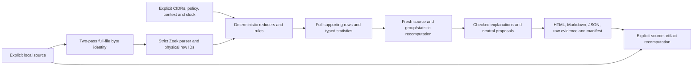

# Architecture and current readiness

The partial local workflow is implemented; required independent native browser evidence and broader acceptance remain pending. Current partial delivery scope and unfinished work are recorded in [DEVELOPMENT-STATUS.md](../DEVELOPMENT-STATUS.md). `local-cli-mvp/1` uses the existing Python CLI/static-artifact path; MCP distribution is deferred. The canonical Event/Metric dependency has been updated with its complete source/schema closure; the CLI explicitly installs its S8 snapshot backend/resolver and canonical required-reference assessment. See [local-cli-mvp.md](local-cli-mvp.md) for its source/denominator/cap boundaries.

Firewall Traffic Analyst is a local Python3.12 CLI. It reads an explicitly supplied Zeek conn TSV/JSONL file, computes deterministic observations, checks explanatory claims against fresh source evidence, and writes inert artifacts to a new directory. It has no server, hosted database, authentication system, device writer or default model dispatch. The original file remains the caller's source of truth; a report is a reproducible snapshot.

## Source and observation boundaries

`domain/parsers` validates declared TSV shape or JSONL structure, exact microsecond times, addresses, transports and counters. Row identity is the full raw file SHA256 plus physical line, including headers and malformed suffix bytes in the file digest; repeated UIDs remain distinct. `shared/rulesengine/rows.py` releases a bounded scan only after matching full-file hash passes. Overlong, oversized, quarantined, capped and unavailable inputs have explicit states/counts; an unknown count is never zero. Parser profile1.1 propagates declared capture-loss/partial-analysis signals into existing quality flags. A complete physical parse does not imply complete capture.

`domain/rules` owns network meanings and fixed policy/context matching. Generic windows, support aggregation, group identity, claims and proposals live in `shared/rulesengine`. Explicit CIDRs determine direction; traffic does not infer permitted peers/services. Contexts are bounded and rule-specific, and suppressed candidates remain visible. Partial groups produce investigation text. The rejected-then-established connection diagnostic cannot establish a literal firewall-policy change. The authoritative mechanics and bounds are in code, config/rules.json and docs/LIMITATIONS.md; this document is not a second threshold registry.

`domain/rules/evidence.py` reparses and rebuilds the actual group catalogue. The generic checker recomputes every accepted statistic over its declared full support or explicitly labelled subset, verifies units/formatters and requires a meaningful observed-statistic sentence. Display examples cannot substitute for aggregate support. Proposals preserve exact observed directional tuples and sparse ports; no device command is emitted or applied.

## Reporting and verification

`pipeline.py` builds the complete bounded artifact set in memory. It resolves every supporting original row into `evidence.json`, then revalidates the source generation before returning artifacts. Publication writes exclusively into a new directory, with `manifest.json` last. A failed write leaves an incomplete directory without a completion marker. There is no overwrite or cleanup of another process's output.

`reporting/render.py` displays recorded states, channels, units/known/unknown counts, support identities, checked sentence labels, context flags and review text. All dynamic HTML is escaped text, including the expandable complete JSON. The HTML has no script/remote dependency; its fixed inline style is CSP hash-bound. Markdown uses the same semantic HTML. The manifest binds exact artifact bytes but is neither a signature nor policy approval.

`verify` requires an explicit caller input path. It never follows a report-supplied path as a source, bounds artifact reads, checks the exact manifest and recomputes all artifact bytes using typed recorded settings and the installed producer. Tampering, source changes and mismatched producer output fail. Historical producer reproduction is not provided.

## Optional annotation and shared components

Normal CLI analysis disables annotation. The explicit Python offline API in `annotation/offline.py` projects only bounded computed numbers/enums, uses the canonical S6 rules/preparation/wrapper and a canonical S3 packed typed request, then validates a real caller-owned ledger/allocation with zero outbound quota. Flags and proposals remain deterministic across hit, miss, hold, invalid answer and failure. Fractional triage and lookup-versus-source provenance/costs remain separate. Authored synthetic replies test mechanics only; confidence0.6 remains uncalibrated.

The unchanged canonical S3 provider/ledger source is nested under `shared/s3`; S5 supplied-text citation and S6 screening source are under `shared/cited` and `shared/screen`. Each has its own retained license and VENDORED provenance. Their tested offline paths do not imply installed live SDKs, model access or calibrated safety. The S5 Event route uses source-derived original support, a fresh literal-row scan, exact parser/runtime/config/schema descriptor and explicit retained-row backend. Canonical failures remain in the denominator and downgrade affected proposals; whole-source guards surround the batch. Available successor publications are not automatically adopted.

`annotation/report.py` composes a separate offline companion from a verified core and the caller's retained requested-ID frame/canonical accounting objects. It uses the existing actual offline API, brackets lookups with core/source checks and preserves the six core artifacts. Its report labels suggestions/provenance/nulls/costs separately; its manifest binds companion bytes without claiming provider authenticity or model quality. Core verification never triggers annotation lookup. The default CLI remains unchanged; see offline-annotation.md.

`baselines` provides explicitly scoped original public-design comparison proxies. They read a validated complete parsed snapshot, not labels or source paths, and require the publishing caller to revalidate its generation. No RITA/CrowdSec implementation is included or executed. The generic overlap helper solves bounded integer one-to-one assignment. Actual canonical source under `shared/evalkit` supplies strict experiment wires, bounded corpus validation, injected comparison, rates/declared summaries/Wilson, fixed whole-group paired resampling and public aggregate projection. Its synthetic conformance is distinct from S8 domain eligibility/scoring, real provenance, an independent heldout controller or numerical app quality. No generic statistics clone is maintained by S8.

## Acceptance still required

S8's `domain/evaluation` adds an explicitly named public source-observed clock/context mapping, strict full-support matcher, registered local-source catalogue, concrete canonical S2 adapter and count/report callbacks. Actual local rules/proxies and unchanged S2 loader/comparison/report/bootstrap helpers have new hand-toy conformance. Source-cohort counts remain separate from episode/alert supports; all named axes retain explicit NA/status rows. See [canonical-evaluation.md](canonical-evaluation.md). This supplies components for a separately admitted controller, without loading the original corpus or granting execution authority.

The provisional generated source/label freeze does not establish independent isolation or quality. Canonical S1 distribution, original-corpus canonical conversion and independently admitted experiment, additional platform installation and finished-app acceptance remain pending; the scoped Windows wheel supplement is accepted with notes. A moved 60-file local CLI source closure passed its full journey with original-source/network guards and inherited cached dependencies. A later non-editable Windows wheel installation using hash-pinned dependencies passed the 49-row journey and eight canonical citation controls; generator code is excluded from the wheel. Actual model results and numerical benchmark comparisons are unrun. Author checks of the source-rendered report passed at desktop and 390-pixel widths, including keyboard disclosure and malformed states; independent source/semantic checks passed, but native browser observations remain blocked by startup failure. A separate current-renderer wheel passed fresh installation, 15 focused controls and the 49-row journey; independent disposition remains pending. The accepted historical wheel remains a separate artifact. No release, deployment, real-network generalization or external acceptance is claimed. The independent controller must retain expected misses and all eligible benign episodes and execute the exact pinned experiment; later outcome-driven tuning requires a separate declared experiment.
